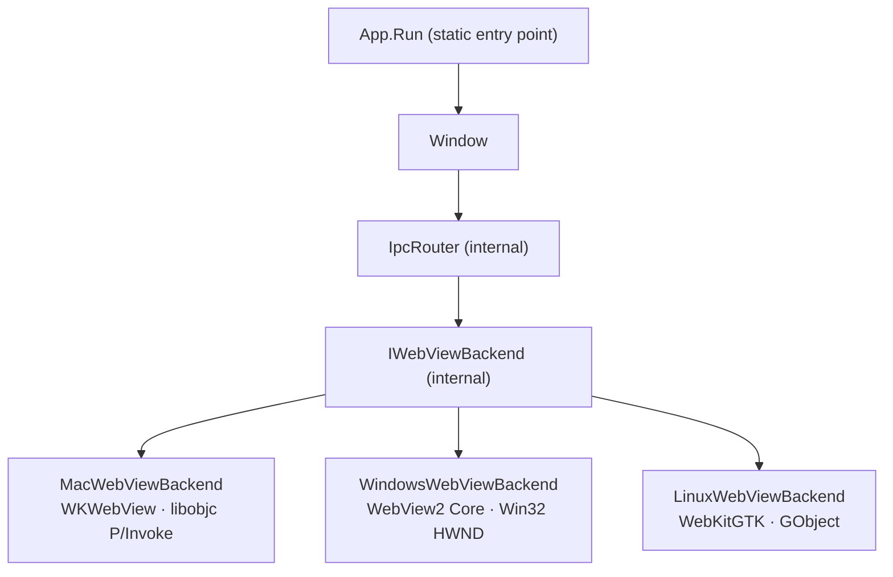
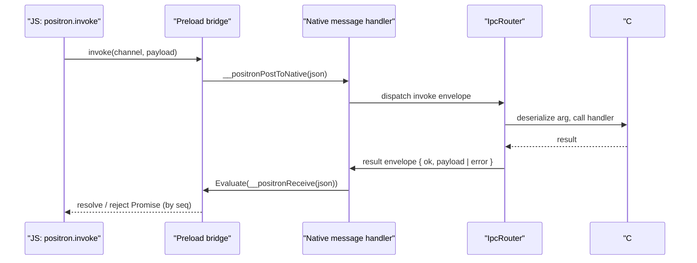
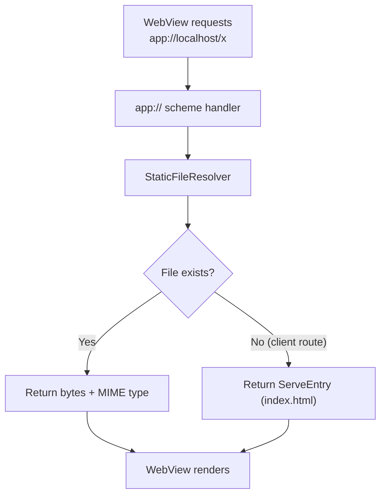

# Architecture

Positron is a single, RID-agnostic managed assembly. There are **no bundled native
binaries** — every platform backend P/Invokes the WebView libraries the operating system
already ships. The only types the library exposes publicly are
[`App`](../api/app.md), [`Window`](../api/window.md),
[`WindowOptions`](../api/window-options.md) (plus `ContextMenuMode`), and the file-dialog
option types. Everything else — the backends, the IPC router, the transport, the serving
pipeline — is `internal`.

## Component overview

`App.Run` builds a `Window`, which owns an `IpcRouter`. The router talks to an
`IWebViewBackend` — the native backend selected for the host OS. The backend is both the
window/WebView host *and* the IPC message transport.

## Backend selection

`App.Run` asks `BackendFactory.Create()` for a backend. Selection is a runtime OS check —
`OperatingSystem.IsMacOS()`, `IsWindows()`, `IsLinux()` — with no bundled engine behind any
branch:

| OS | Backend | Native target |
|----|---------|---------------|
| macOS | `MacWebViewBackend` | WKWebView, reached through the Objective-C runtime via `libobjc` P/Invoke |
| Windows | `WindowsWebViewBackend` | WebView2 Core, hosted in a Win32 window (HWND) |
| Linux | `LinuxWebViewBackend` | WebKitGTK, reached through GObject |

An unsupported OS throws `PlatformNotSupportedException`. Because the single assembly carries
no native payload, there is nothing RID-specific to publish — the managed assembly runs
wherever .NET 11 and a system WebView do.

!!! note "Threading"
    `App.Run` must be called from the process main thread. macOS AppKit requires it; on
    Windows the backend establishes an STA message pump on the calling thread. `App.Run`
    blocks in the native run loop until the window closes.

## Request round trip

An `invoke` from JavaScript is a sequence-correlated request/response. The preload bridge
stamps each call with a monotonic `seq`, posts it to the native side, and holds a Promise open
until the matching `result` envelope comes back. Events (`Window.Emit`) are the reverse: a
fire-and-forget C#→JS push.

See [IPC](ipc.md) for the wire envelope and handler registration.

## Serving a directory over `app://`

When [`WindowOptions.ServeDirectory`](../api/window-options.md) is set, the backend registers
a custom `app://` scheme. WebView requests to `app://localhost/<path>` are intercepted by a
scheme handler and resolved by `StaticFileResolver`: it maps the path to a file and MIME type,
or — for a client-side (history-API) route it does not recognise — falls back to the SPA entry
document (`ServeEntry`, default `index.html`). This gives a built SPA a real web origin rather
than `file://` quirks.

